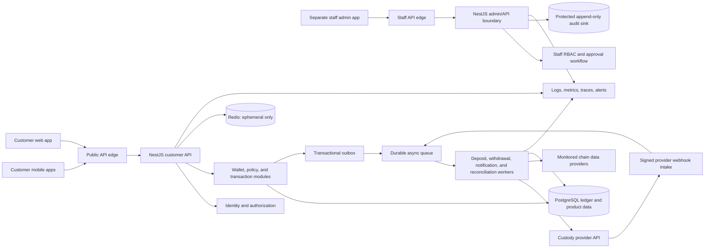
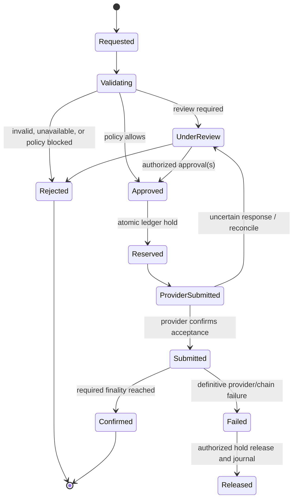

# NUUR WALLET — Architecture Baseline

**Status:** Initial design baseline for review  
**Product model:** Custodial wallet through a professional third-party custody provider  
**Launch scope:** Ethiopia, conditional on required authorization; international expansion is a separate jurisdictional decision  
**Production financial operations:** Not enabled by this design document

## 1. Purpose and boundaries

This document translates the confirmed product direction and security requirements into a reviewable starting architecture. It is a design proposal, not evidence of regulatory approval, custody-provider approval, or production readiness. Qualified legal, compliance, security, and custody specialists must resolve the relevant launch requirements before financial operations are enabled.

NUUR applications manage customer identity, product policy, transaction requests, the internal accounting ledger, reconciliation, and customer support workflows. A contracted custody provider controls signing infrastructure and blockchain execution. NUUR application services must not possess customer signing keys or provider signing secrets.

The existing `wallet-prototype/` remains a browser-only simulated prototype. It is not a custody implementation and must not connect to production credentials or customer assets.

## 2. Confirmed direction and proposed architecture

| Area | Direction |
| --- | --- |
| Custody | Custodial, through a professionally managed provider |
| Chains | Ethereum, BNB Chain, Solana, and Polygon; network identities remain explicit and separate |
| Clients | React Native + Expo mobile apps, Next.js web app, separate internal admin app |
| Backend | Node.js, NestJS, TypeScript, REST/OpenAPI, WebSockets only where live status materially helps |
| Data | PostgreSQL as system of record; Redis for short-lived cache, throttling, and coordination only |
| Async processing | Durable queue/broker and outbox/inbox processing; provider not yet selected |
| EVM integration | Viem behind network-specific adapters |
| Solana integration | A maintained Solana SDK behind a network-specific adapter |
| Initial service shape | Proposed modular NestJS backend with isolated workers and strict module ownership; split services only when scale, isolation, or provider requirements justify it |

This shape keeps accounting and authorization boundaries explicit without requiring a premature microservice fleet. Modules communicate through owned interfaces and durable events; they do not share repository-level database access across ownership boundaries.

## 3. System context and trust boundaries

Trust boundaries:

1. **Untrusted client boundary:** Mobile and browser input is untrusted. Clients never make custody decisions or contain signing credentials.
2. **Customer API boundary:** Authentication alone is insufficient; every wallet and transaction operation also checks ownership, state, limits, and policy.
3. **Staff control boundary:** The internal admin app uses separate staff identities, stronger authentication, distinct roles, and approval workflows. Customer support cannot sign or directly move assets.
4. **Custody-provider boundary:** Provider requests are authenticated with managed secrets. Webhooks are verified, deduplicated, and treated as untrusted until validated.
5. **Blockchain data boundary:** RPC/indexer responses are external observations. Network identity, asset identity, confirmation/finality, and duplicates are checked before ledger effects.
6. **Data boundary:** PostgreSQL is authoritative for NUUR product records and accounting. Redis is never authoritative for balances, approvals, or custody state.

## 4. Backend module boundaries

| Module | Owns | Must not own |
| --- | --- | --- |
| Identity and authentication | Customer/staff identities, MFA/passkeys, sessions, recovery, login risk | Wallet balances or custody credentials |
| Customer accounts | Customer profile, verification workflow references, account status | Signing authority |
| Wallet management | Customer wallet views and provider wallet references | Private keys or provider secrets |
| Network registry | Chain IDs, network identifiers, enabled state, finality policy, provider configuration references | Asset approval |
| Asset registry | Network-specific token/mint identity, decimals, approval state, metadata | Customer balances |
| Ledger | Immutable journal headers/entries, holds, customer liability balances, reversals | Mutable provider-reported balance as customer truth |
| Deposit monitoring | Chain/provider observations, confirmation tracking, deposit state transitions | Directly editing posted journal rows |
| Withdrawal management | Idempotent intents, policy checks, review state, customer-facing state | Direct signing or key access |
| Custody integration | Provider adapter, request signing, operation references, webhook verification | Customer-facing authentication |
| Network adapters | Chain-specific read/monitor operations and identity/finality checks | Custody authorization policy |
| Transaction history | Read model assembled from ledger and transaction state | Independent balance mutation |
| Risk and compliance workflows | Policy inputs, review cases, restrictions, evidence references | Unreviewable or silent asset movement |
| Notifications | Security and transaction notices, delivery status | Authentication or custody decisions |
| Administration | Staff workflows, approvals, access reviews, support views | Unrestricted custody access |
| Audit logging | Append-only security and business-action records | Sensitive secrets or key material |
| Monitoring and reconciliation | Provider/chain/ledger comparisons, discrepancies, alerts | Repairing discrepancies without an authorized journal process |

Each module exposes a versioned application interface and owns its writes. Shared PostgreSQL can be used initially, but use module-owned schemas/repositories and database roles; cross-module state changes go through application interfaces or durable events.

## 5. Accounting and transaction model

### Ledger invariants

- The ledger is the authoritative record of customer liabilities. Provider dashboards and blockchain observations are reconciliation inputs, not substitutes for NUUR's ledger.
- Every posted journal balances debits and credits per asset identity. Entries are append-only; corrections use linked reversal/adjustment journals with an actor, reason, and audit record.
- Store crypto quantities as integer atomic units (or exact `NUMERIC` values where provider precision requires it), never IEEE floating point. Asset decimals and network identity come from an approved, versioned registry record.
- A balance is derived from posted journal entries plus explicit holds/reservations. Cached totals are rebuildable read models.
- Enforce uniqueness and idempotency in PostgreSQL, not only in application memory or Redis.
- Keep accounting currency/asset identity explicit on every entry. Never aggregate same-symbol assets across different networks as if they were interchangeable.

### Suggested core records

Names are conceptual; schema details require review before migrations.

- `customers`, `staff_users`, `sessions`, `authentication_factors`, `access_roles`, `role_assignments`
- `wallets`, `wallet_network_accounts`, `custody_provider_accounts`
- `networks`, `assets`, `asset_networks`, `asset_approvals`
- `ledger_accounts`, `journal_transactions`, `ledger_entries`, `balance_holds`
- `deposit_observations`, `deposits`, `withdrawal_requests`, `transaction_state_events`
- `custody_operations`, `provider_events`, `chain_observations`, `reconciliation_runs`, `reconciliation_discrepancies`
- `idempotency_records`, `outbox_events`, `inbox_events`, `approval_requests`, `audit_events`

Store provider secrets only in approved managed secrets infrastructure. PostgreSQL stores secret references and provider operation IDs, not credentials or signing material.

### Deposit lifecycle

1. Observe a candidate event from a custody webhook and/or trusted chain monitor.
2. Validate provider signature where applicable, network identity, approved asset identity, destination mapping, transaction/log/mint identifiers, and event uniqueness.
3. Create a pending deposit record; do not make an unconfirmed event spendable.
4. Advance confirmation/finality state according to the network policy and record each transition.
5. Post one balanced journal once the configured credit condition is met. Enforce uniqueness on the canonical event identity so retries cannot credit twice.
6. Reconcile the resulting customer liability with provider custody and chain observations.

### Withdrawal lifecycle

Before accepting a withdrawal: authenticate, authorize wallet ownership, validate network and approved asset, validate destination format and policy, apply available-balance/limit/risk checks, require step-up authentication or staff approval when policy demands it, and require an idempotency key. Reserve funds atomically before provider submission. Treat timeouts as **unknown**, query/reconcile provider state, and do not blindly submit again. Record fees as estimated and final separately, with the final amount reconciled to provider results.

## 6. API and event contract principles

- Version public APIs (`/v1`) and publish OpenAPI for customer and staff surfaces separately.
- Every protected request authenticates and applies resource-level authorization. Never trust client-supplied customer, wallet, asset, network, fee, or status fields without server-side resolution.
- Withdrawal creation accepts an idempotency key and returns a request identifier plus explicit state. Retrying the same key returns the original operation; a conflicting payload with the same key is rejected.
- Use transactional outbox records for state change plus event publication. Consumers use inbox/deduplication records and tolerate at-least-once delivery.
- Provider webhook intake verifies the provider's documented signature, timestamp/replay requirements, and unique event identifier before enqueueing. Return provider-safe errors without internal details.
- Use explicit CORS origins, secure headers, TLS, request validation, output encoding, request size limits, rate limits, and abuse controls.
- WebSockets, if used, expose authorized status updates only; clients can always recover state using REST.
- API responses distinguish requested, under review, submitted, confirmed, failed, rejected, and unknown/reconciling states. Do not imply finality from request acceptance.

## 7. Identity, authorization, and administration

- Use short-lived access tokens and protected refresh sessions, session revocation, MFA, and phishing-resistant factors where supported. Password authentication uses Argon2id or an equivalently reviewed configuration; public responses avoid account enumeration.
- Apply customer resource authorization to every wallet, asset, deposit, withdrawal, and history read/write.
- Separate customer and staff identity realms and deployments. Staff require strong MFA, managed devices where appropriate, and just-in-time/periodic access review.
- Define narrow roles for Support, Compliance, Finance/Reconciliation, Security, Custody Operations, and Administrator. A role does not itself bypass transaction policy.
- Support staff can assist and view the minimum required redacted fields but cannot call signing functions or approve their own sensitive operations.
- Sensitive operational actions use maker-checker approvals: the requester cannot be the sole approver. All requests, decisions, permission changes, and resulting operations are audited.
- Posted journal rows are immutable for every role. Reconciliation corrections use documented reversals or adjustments with independent approval.

## 8. Data protection and audit

- Encrypt transport with modern TLS and use managed encryption at rest for databases, backups, object storage, and audit sinks. Restrict database access by service identity and operational responsibility.
- Keep authentication data, identity information, ledger records, provider references, and secrets separated by access boundary. Avoid collecting unnecessary personal information.
- Never log passwords, access/refresh tokens, MFA values, recovery secrets, private keys, provider credentials, or full sensitive payloads. Use structured logs, redaction, and correlation IDs.
- Maintain a separate protected audit trail for authentication, authorization denials, ledger postings/reversals, transaction transitions, custody operation references, approvals, role changes, and staff access.
- Make audit records append-only or tamper-evident with restricted write/read roles, integrity monitoring, retention policy, and export to a separately administered sink.
- Backups are encrypted and access-controlled; restoration is exercised. Retention/deletion schedules require jurisdictional and contractual review.

## 9. Infrastructure and operations

- Separate development, staging, and production accounts, networks, databases, queues, and secrets. Production custody credentials are never present in development or prototype environments.
- Keep databases, Redis, queues, worker endpoints, and admin services private. Expose only the required customer API and separately protected admin entry point.
- Use managed secrets infrastructure, workload identities, least-privilege deployment roles, controlled approvals, infrastructure-as-code review, image/dependency scanning, and an SBOM.
- Encrypt internal service paths where appropriate. Add network egress allowlists for provider and chain integrations where operationally viable.
- Centralize redacted logs, metrics, traces, alerts, dashboards, and on-call procedures. Alert on ledger imbalance, provider/chain divergence, duplicate events, delayed finality, unusual admin actions, auth abuse, and service health.
- Define tested provider outage, uncertain withdrawal, queue backlog, chain reorganization, reconciliation discrepancy, key-provider transition, incident, and disaster-recovery runbooks.
- Keep public customer app, staff admin app, backend APIs, asynchronous workers, and data services as separate deployment/permission units even if some backend modules initially share a codebase.

## 10. Security development lifecycle and launch gates

Require code review, dependency scanning, SAST, DAST against suitable nonproduction environments, container and infrastructure scans, secrets scanning, automated tests, vulnerability triage, and independent penetration testing. Maintain threat models as custody, asset, chain, and admin features change. Apply OWASP ASVS, OWASP MASVS, and NIST CSF 2.0 as engineering references; the compliance owner maps applicable control obligations with qualified professionals.

Every feature must pass the pre-implementation checklist in [`SECURITY_ENGINEERING_REQUIREMENTS.md`](./SECURITY_ENGINEERING_REQUIREMENTS.md): risks, data and boundaries, authentication and authorization, validation and audit, relevant security tests written first, and unresolved concerns. The checklist applies to prototypes and customer/staff UI as well as backend and infrastructure changes. If a feature conflicts with this architecture, pause implementation and propose a safer design.

Production financial operation remains disabled until all of the following have evidence and named approval:

1. Custody-provider security, governance, contractual duties, key lifecycle, recovery, rotation, and exit have been independently assessed.
2. Required legal and regulatory approvals for the product, launch geography, assets, and operating model have been obtained.
3. Authentication, authorization, account recovery, and customer/staff separation have passed security review.
4. Ledger invariants, holds, reversals, balancing, and reconciliation tests pass.
5. Duplicate requests, provider webhooks, queue redelivery, and uncertain provider responses have been tested.
6. Security findings are assessed and critical findings are resolved; remaining findings have documented risk owners and disposition.
7. Backup restoration and disaster recovery are tested against approved objectives.
8. Incident response is documented, assigned, and exercised.
9. Staff/admin permissions and approval policies have been independently reviewed.
10. Required security, compliance, custody, finance, and operational approvals are recorded.

## 11. Delivery sequence

1. **Resolve foundational decisions:** target legal operating model, custody provider and responsibilities, identity provider, cloud/region, queue, RPC providers, recovery/support model, initial approved asset identities, and operational ownership.
2. **Threat model and control mapping:** data classification, assets/threat actors, trust boundaries, abuse cases, security controls, and evidence owners.
3. **Build nonproduction foundations:** repository/workspace boundaries, CI, IaC, secrets separation, observability, NestJS module skeleton, PostgreSQL migrations, OpenAPI, and staff/customer app separation. Use fake custody and chain adapters.
4. **Prove accounting:** ledger invariants, idempotency, holds, reversals, concurrent withdrawals, event deduplication, and reconciliation using deterministic fixtures.
5. **Integrate selected providers in sandbox:** custody and RPC adapters behind interfaces; verified webhooks; failure and uncertain-state handling.
6. **Complete security and operational validation:** independent assessment, runbooks, restore/incident exercises, access review, and release-gate evidence.
7. **Enable a jurisdictionally authorized launch only after approvals:** staged rollout, monitored limits, reconciliation sign-off, and an exercised stop/suspension procedure.

## 12. Decisions still open

These choices should be recorded as architecture decision records before implementation depends on them:

- Custody provider, supported account model, approval policy, service levels, API/webhook specifications, and contractual allocation of responsibility.
- Initial legal entity, required Ethiopia authorizations, launch scope, customer verification/risk-control obligations, data residency/retention, and approved customer segments.
- Cloud provider and region, managed PostgreSQL/Redis/queue/secrets services, backup objectives, and disaster-recovery region.
- Identity/MFA provider and account recovery process; staff identity integration and managed-device policy.
- Durable broker/queue and event delivery/retention model.
- RPC/indexer providers and independent monitoring strategy for each network.
- Exact network IDs, token/mint/contract identities, decimals, custody support, and formal approval process for NUUR Coin and each other asset.
- Customer balance availability/finality policy per network and provider.
- Risk thresholds, transaction limits, maker-checker rules, suspicious-activity case ownership, and customer support procedures.
- Service availability objectives, reconciliation cadence, incident command, and business continuity owners.

## 13. Repository relationship

The repository currently contains the Nuur Coin Solidity contract and `wallet-prototype/`, a simulated browser UI. This baseline does not create a backend, select a custody provider, connect to a chain, or claim production readiness. The next implementation step, after review of the threat model and decision records, is nonproduction service scaffolding with fake provider adapters and security tests authored before feature code.

The initial threat analysis is in [`NUUR_WALLET_THREAT_MODEL.md`](./NUUR_WALLET_THREAT_MODEL.md); the decision log is in [`NUUR_WALLET_ADRS.md`](./NUUR_WALLET_ADRS.md). Proposed decisions remain reviewable and are not silently treated as confirmed product choices.
