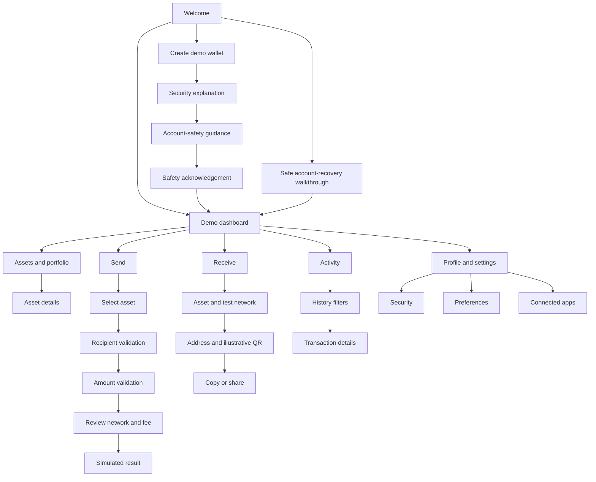

# NUUR Wallet — design and developer handoff

## Product boundary

This folder is a browser based, high fidelity interaction prototype for review. It is separate from the Solidity token. Its wallet, balances, addresses, QR graphic, activity, and prices are sample data. There are no wallet libraries, RPC endpoints, backend services, persistence, key generation, signing, or transaction broadcasts.

## Design system

| Token | Value | Use |
| --- | --- | --- |
| Midnight Navy | `#101827` | App canvas |
| Secondary Navy | `#1D2A3A` | Elevated panels |
| Premium Gold | `#EFCB64` | Primary action, focus, active navigation |
| Emerald | `#20C997` | Confirmed and received states |
| White | `#FFFFFF` | Primary text and contrast |
| Secondary Text | `#AEBACB` | Supporting copy |
| Error | `#F06464` | Validation and failure states |

Typography uses Inter when installed, with system sans-serif fallbacks. Financial values use tabular numerals. The implementation keeps spacing, radii, colors, and surfaces as CSS variables and groups components by shared classes. Machine readable starter tokens are in `design-tokens.json` for transfer into Figma variables or another design tool.

## Component inventory

- Brand mark and wordmark
- Desktop sidebar and compact mobile bottom navigation
- Testnet network selector and status pill
- Portfolio balance card with visibility toggle and trend graphic
- Asset icon, asset row, allocation graphic, and asset detail panel
- Send and receive primary actions
- Activity row, history table, transaction status chip, filter chip
- Text and amount fields, asset picker, network picker, review rows
- Transaction confirmation/result panel and receive address/QR panel
- Security and preference setting rows, toggle switches, empty state, offline notice, demo notice, and simulated loading state

## Screen and responsive notes

The prototype uses one responsive web surface. Below 760 px, the sidebar becomes a six item bottom bar, dashboard cards stack, and forms become single column. At 760 px and wider, the sidebar returns and content uses multi-column grids. At 1050 px and below, overview cards stack while quick actions use a four column row. On 320–380 px screens, navigation, values, and asset rows compress while touch controls remain usable. The desktop canvas is fluid and capped at 1260 px inside the 1440 px reference viewport.

| Reference | Layout behavior |
| --- | --- |
| 390 × 844 mobile | Single column, sticky top bar, fixed bottom navigation |
| 768 px+ tablet | Sidebar navigation and adaptable card grids |
| 1440 × 900 desktop | 248 px sidebar, central content, two-column dashboard and detail panels |

All controls are semantic buttons, inputs, selects, or navigation elements with labels. Keyboard focus is visible. Send validation is local, and the review step names the selected test network before the user simulates a transfer.

## User flow map

## Interaction cases for product review

These are manual review scenarios, not automated or executed test results.

1. **Onboarding:** Create a demo account and move through custody/security and account-safety education. The continuation control stays disabled until the acknowledgement checkbox is selected. No credentials or personal information are collected.
2. **Account recovery:** Follow the recovery walkthrough and confirm that no identity or verification fields are shown before opening the sample account.
3. **Dashboard:** Toggle balance visibility, open portfolio, navigate to an asset, and return using navigation controls.
4. **Network selection:** Change between Sepolia, Base Sepolia, and Polygon Amoy. Confirm the active network is visible in the header and the send/receive flows.
5. **Send validation:** Attempt to continue with an empty/invalid address and with zero, negative, or over-balance amount. Confirm inline errors appear and do not advance the flow.
6. **Send review:** Enter a valid 0x address and in-range amount. Confirm the selected asset, destination, fee, and testnet name appear before simulation.
7. **Simulated result:** Confirm the action adds a demo history row and updates sample balances without opening a wallet prompt or network request.
8. **Receive:** Change asset and network, copy the demo address, and use share where supported. The displayed QR is explicitly illustrative and is not a scannable payment code.
9. **Activity:** Filter all, sent, received, and pending. Open a row and verify the detail view says the reference is simulated.
10. **Offline state:** In Preferences, enable Offline preview. Confirm the cached data banner appears and Send cannot be opened. Turn the preview off to restore the flow.
11. **Settings:** Navigate Profile, Security, Preferences, and Connected apps. Toggle controls and currency selection; verify no system biometric prompt or app permission request occurs.
12. **Responsive and keyboard:** Review at 390 × 844, 768 px, and 1440 × 900. Tab through actions, check visible focus, and confirm the bottom nav is only used at mobile widths.

## Security and architecture notes

- The UI intentionally does not accept private keys or recovery phrases.
- No request is made to a wallet provider, chain, API, or application server. The page has no remote font or script dependency.
- Any simulated send only updates the in-memory JavaScript state for this tab. Reloading returns to the starting sample balances/activity.
- Demo network labels are a UX preview; they do not imply supported network RPC or testnet deployment.
- A production wallet would need an independently assessed custody provider, documented authorization and approval policies, secure account recovery, a durable ledger, transaction reconciliation, dependency review, and independent security assessment.
- Nuur Coin support here is illustrative; no token contract address or on-chain lookup is configured.

## Source map

- `index.html` — app entry point
- `styles.css` — palette, responsive layouts, components, and typography
- `app.js` — screen rendering and local interaction state
- `design-tokens.json` — Figma-ready starter tokens
- `HANDOFF.md` — component inventory, flows, interaction cases, responsive and security notes
